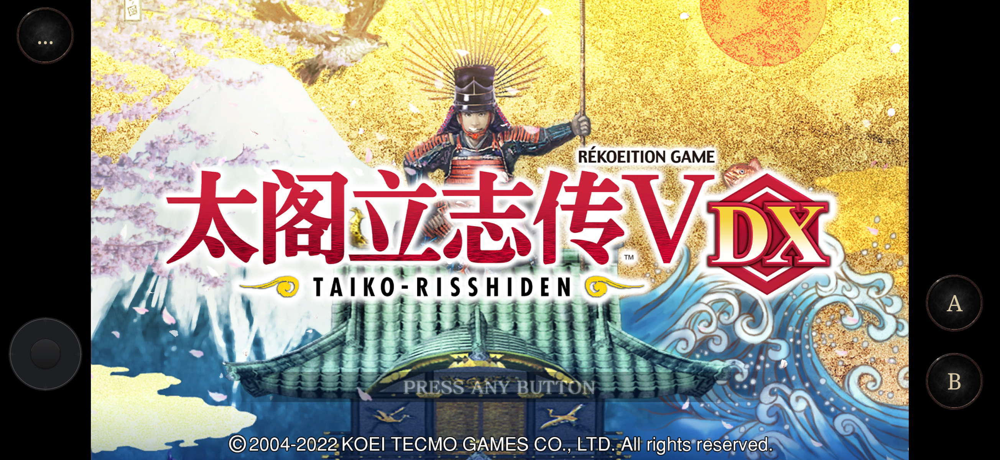
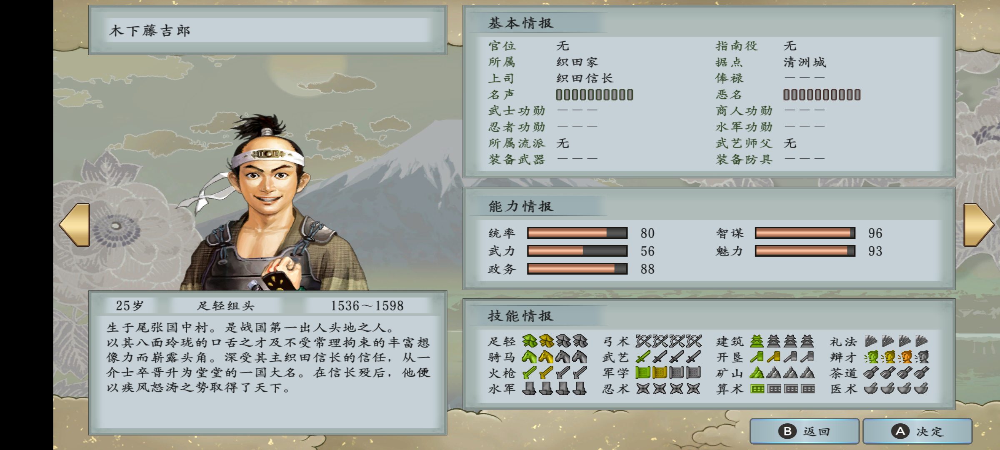
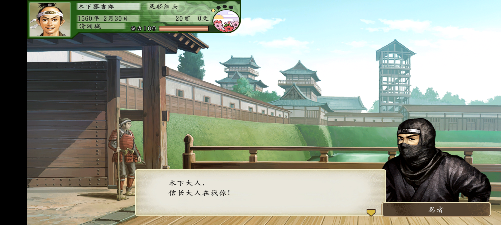

# Taikou5 Mobile

**An experimental, open-source Android compatibility layer for Taikou Risshiden V DX (太阁立志传 V DX).** Runs the original Switch ARM64 program with Horizon services and NVN graphics translated to Vulkan. Bring your own legally obtained game files.

[简体中文](README.zh-CN.md) · [Game files](docs/GAME_FILES.md) · [Build the APK](docs/BUILD.md) · [Install and play](docs/ANDROID.md) · [Upstream and licenses](docs/UPSTREAM.md)

Android 12+ · ARM64 · Vulkan 1.1 baseline · Switch title `0100346017304000`, update `v196608` · MIT (see third-party notices) · **No game content provided**

## Screenshots

Actual Android emulator captures. The title screen is from **0.1.2-preview / v196608**. The character profile and opening dialogue are from the **earlier base-v0 bring-up**, before the current touch overlay; they are not evidence that the latest updated build reaches those scenes. In the latest capture attempt, entering character details aborted on an unsupported partial CPU/GPU texture alias operation; see [validation notes](docs/VALIDATION.md).

**Title screen — centered 16:9 with virtual controls**

**Kinoshita Tokichiro — introduction, attributes and skills (earlier base-game build)**

**First conversation outside Kiyosu Castle (earlier base-game build)**

Screenshots illustrate compatibility only. In-game artwork/text belong to their respective rights holders; the code license does not license game content. No playable game files are supplied. [Capture details](docs/screenshots/README.md).

## What is included

- The compatibility runtime, Android shell and Vulkan replay backend.
- Centered 16:9 presentation, the updated game's own touchscreen input, a virtual left stick, A/B and expandable auxiliary buttons.
- Scripts to rewrite your original ExeFS, extract/translate your own shaders and create a private import ZIP.
- A shell APK containing runtime code and project control artwork only. It contains no game executable, RomFS, translated game shaders or saves.

This is an early preview, not a claim of complete compatibility. The earlier base-game build reached the opening conversation outside Kiyosu Castle in the emulator. The updated build reached title/scenario selection and accepted native touch. Menu/selection samples in the development emulator measured approximately 51–54 FPS; movies were slower. These are emulator observations, not phone benchmarks or full-playthrough results. [Limitations](docs/ANDROID.md#known-limitations).

## Start here

1. Install `Taikou5-mobile-preview.apk` from [Releases](https://github.com/wdjwxh/Taikou5-mobile/releases). Artifact details and checksums are listed in [artifacts/README.md](artifacts/README.md).
2. Prepare a complete **base + v196608 update merged dump** from your own copy. Keep `ExeFS/` and `RomFS/` outside this repository. The Cat Officer DLC is excluded.
3. Run [scripts/prepare_game.py](scripts/prepare_game.py) following [Game files](docs/GAME_FILES.md). It produces a **private game-content ZIP**; never upload it to this repository or a public release.
4. Copy that ZIP to your phone using USB, a file manager or your preferred transfer method. Open the shell, select **Import personal game ZIP**, choose the ZIP in Android's file picker and wait for verification.
5. Import completion launches the game automatically; later app launches skip the import page while the verified resources are complete. After successful import, delete the transfer ZIP from Downloads if desired. The app uses its extracted private copy.

No ADB or root is needed for normal import. Installing a shell alone does not provide the game. Updating the APK with the same package/signature retains imported files and saves; uninstalling deletes app-private data.

## Controls

| Input | Action |
|---|---|
| Tap the game image | Original updated-game touchscreen input |
| Left stick | Analog input plus D-pad directions for menu navigation |
| A / B | Confirm / cancel, as interpreted by the current game screen |
| … | Show/hide X/Y, L/R, ZL/ZR, +/− and stick-click buttons |

Buttons remain in the side margins on wide screens. Gesture/pinch zoom is not implemented. Physical controller button mappings exist, but complete analog-controller compatibility is not verified.

## Based on upstream work

This project would not exist without:

- **[seedds/nxnative](https://github.com/seedds/nxnative)** — the original generic native execution model, Horizon HLE, NVN command recording, game profile and shader extraction/translation framework. Baseline: [`a08bbdd3ba144a6de4db39576cd0512786573eb7`](https://github.com/seedds/nxnative/commit/a08bbdd3ba144a6de4db39576cd0512786573eb7).
- **[jhaizhou-ops/d2r-mobile](https://github.com/jhaizhou-ops/d2r-mobile)** — the official Android Vulkan backend, presentation layer, bionic/ELF adaptations, Android NSO rewriting and virtual control rendering/artwork. Baseline: v2.0.0, [`b811b90172f4eb40ec1bc89d903308e0c5ab88d0`](https://github.com/jhaizhou-ops/d2r-mobile/commit/b811b90172f4eb40ec1bc89d903308e0c5ab88d0). Its Vulkan work also credits biglawine's HarmonyOS port.

Our integration adds the Taikou profile, Android host/audio/movie bridges, current NVN command/shader compatibility, bounded vertex snapshot copies, Taikou controls and personal-resource import/packaging. We do not claim upstream runtime, renderer or artwork as original work. See [UPSTREAM](docs/UPSTREAM.md) for component provenance and retained licenses.

## Development and distribution

- [Build from source](docs/BUILD.md): shell builds need no game files.
- [Game input and private packaging](docs/GAME_FILES.md): exact supported version, prerequisites and commands.
- [Android installation, storage and troubleshooting](docs/ANDROID.md).
- [Derived interface metadata](docs/DERIVED.md), [contributing](CONTRIBUTING.md), [security](SECURITY.md), [changelog](CHANGELOG.md).

No affiliation with Koei Tecmo, Nintendo, or the upstream maintainers is implied. Game content and trademarks belong to their respective owners. The MIT license covers the compatibility code under its applicable notices; it grants no rights to game content. Do not submit game files, keys, saves or personal import ZIPs in issues or pull requests.

[Local validation / 本地验证记录](docs/VALIDATION.md)
